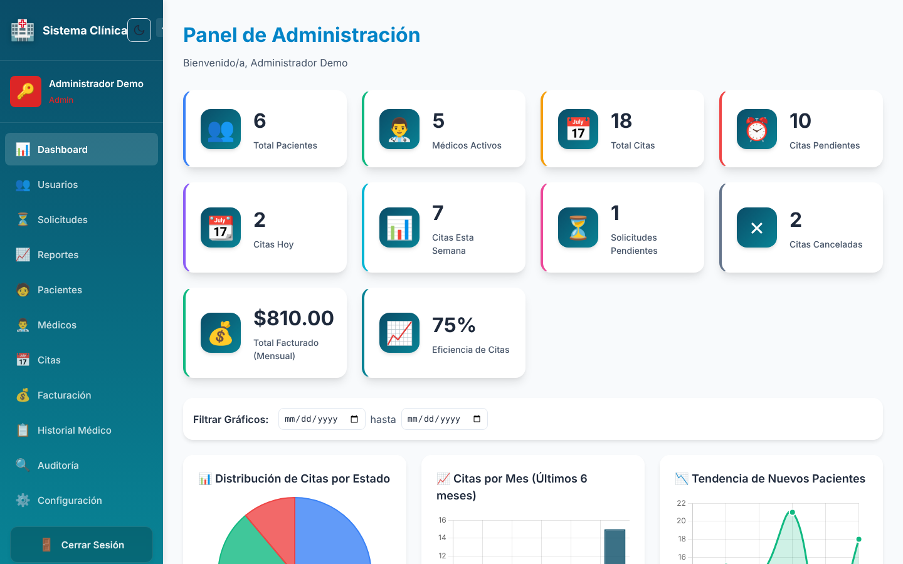
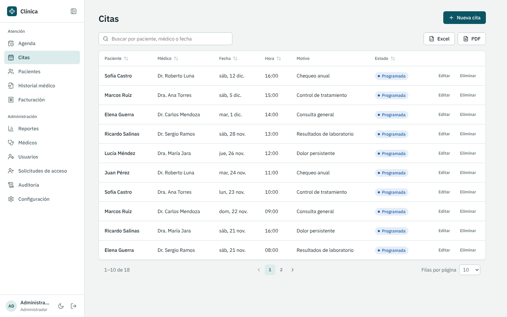
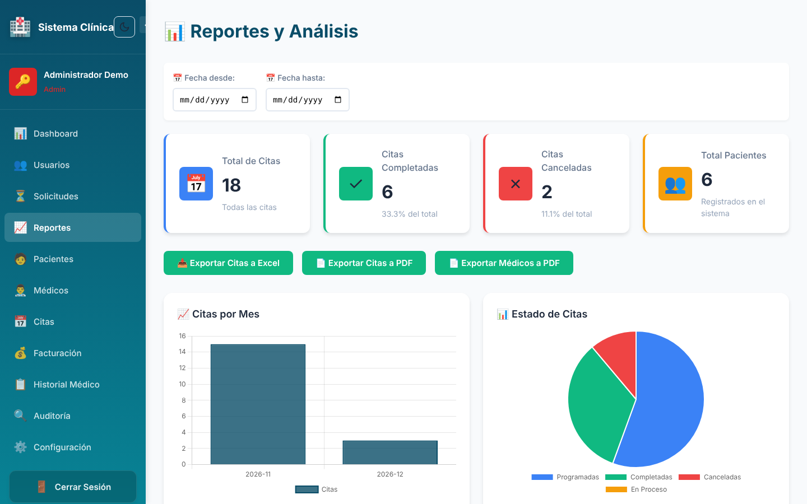
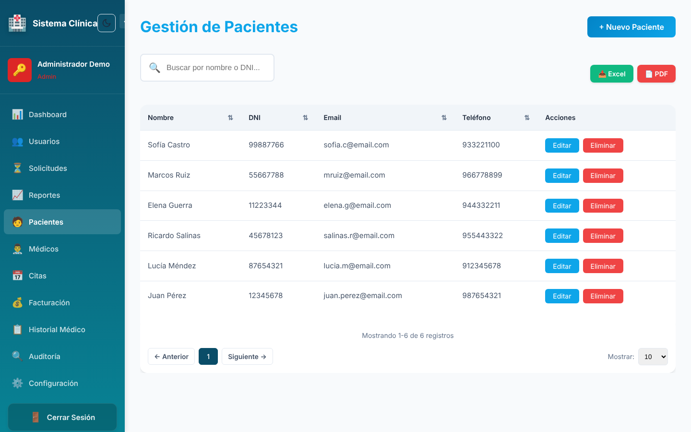
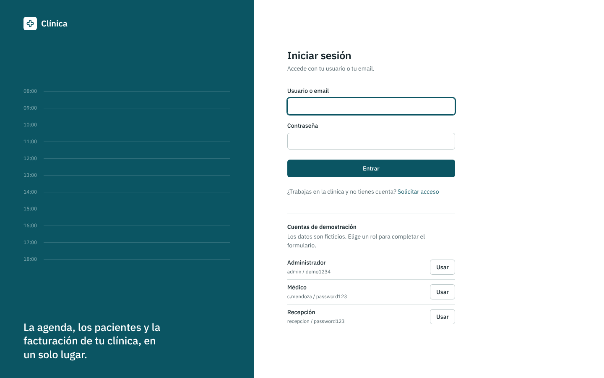
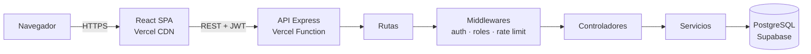

# Sistema de Gestión de Clínica

[](https://github.com/lino07w/sistema-clinica/actions/workflows/ci.yml)


Aplicación **full stack** para administrar una clínica: pacientes, médicos, citas, historial médico, facturación, reportes y auditoría, con **control de acceso por roles**.

**🔗 Demo en vivo:** https://sistema-clinica-blue.vercel.app
**📚 API (Swagger):** https://sistema-clinica-api-one.vercel.app/api-docs

| Rol | Usuario | Contraseña |
|---|---|---|
| Administrador | `admin` | `demo1234` |
| Médico | `c.mendoza` | `password123` |
| Recepcionista | `recepcion` | `password123` |

> Los datos de la demo son ficticios. Si los modificas, otros visitantes verán tus cambios.



<details>
<summary>Más capturas</summary>

| Citas | Reportes |
|---|---|
|  |  |
| **Pacientes** | **Login** |
|  |  |

</details>

---

## Funcionalidades

- **Autenticación JWT** con registro de profesionales sujeto a **aprobación del administrador**.
- **4 roles** (administrador, médico, recepcionista, paciente) con permisos verificados en el backend y en la UI. Un médico sólo ve y modifica sus propias citas.
- **CRUD** de pacientes, médicos, citas, historial médico, facturas y usuarios.
- Detección de **conflictos de horario** (un médico no puede tener dos citas a la misma hora).
- **Dashboard y reportes** con gráficos (Chart.js) y filtros por fechas.
- **Exportación a Excel y PDF**.
- **Auditoría**: registro de quién hizo qué y cuándo.
- Email de confirmación de citas y recuperación de contraseña.
- Modo oscuro.

## Stack

| Capa | Tecnologías |
|---|---|
| Frontend | React 19, Vite, React Router 7, React Hook Form + Zod, Axios, Chart.js |
| Backend | Node.js 22, Express 5, Sequelize 6, JWT, bcrypt, Helmet, express-rate-limit, Swagger |
| Base de datos | PostgreSQL 16 |
| Calidad | Jest + Supertest, ESLint, GitHub Actions |
| Infraestructura | Docker / Docker Compose, Vercel (frontend estático + backend serverless), Supabase (PostgreSQL) |

## Arquitectura



El backend sigue una **arquitectura en capas**:

```
clinica-backend/
├── app.js            # Definición de Express (sin listen): reutilizada por server, Vercel y tests
├── server.js         # Servidor HTTP tradicional (local / Docker)
├── api/index.js      # Entrada serverless para Vercel
├── bootstrap.js      # Inicialización idempotente de la BD
├── config/           # Configuración validada desde variables de entorno (fail-fast)
├── routes/           # Endpoints y permisos por rol
├── middleware/       # Autenticación, autorización y manejo centralizado de errores
├── controllers/      # Capa HTTP: lee el request y arma la respuesta
├── services/         # Lógica de negocio; lanza ApiError con el código HTTP correcto
├── models/           # Modelos Sequelize y relaciones
├── seeders/          # Datos de demostración
└── tests/            # Tests de integración (Jest + Supertest)
```

### Decisiones técnicas

- **`app.js` separado de `server.js`**: la misma aplicación Express corre como servidor tradicional, como función serverless en Vercel y dentro de los tests, sin duplicar código.
- **Errores tipados (`ApiError`)**: los servicios lanzan errores con su código HTTP (400/404/409) y un único middleware arma la respuesta. En producción nunca se exponen stacks ni mensajes internos.
- **Configuración fail-fast**: en producción la app no arranca si falta `JWT_SECRET`; no hay secretos por defecto.
- **Seguridad**: whitelist de campos en el registro (evita *mass assignment*), contraseñas y tokens de recuperación hasheados, el hash nunca se serializa en las respuestas, respuestas que no permiten enumerar usuarios, HTML escapado en emails, Helmet y rate limiting.
- **Rendimiento del frontend**: *code splitting* por ruta y carga diferida de las librerías de exportación. El bundle inicial pasó de 1,4 MB a 242 kB (79 kB gzip).

## Ejecutar en local

### Opción A: Docker

```bash
cp .env.example .env        # define JWT_SECRET y DEFAULT_ADMIN_PASSWORD
docker compose up -d --build
docker compose exec backend npm run seed   # opcional: datos de demostración
```

- Frontend: http://localhost
- API: http://localhost:3000 · Swagger: http://localhost:3000/api-docs

### Opción B: Node.js 22 + PostgreSQL

```bash
# Backend
cd clinica-backend
cp .env.example .env        # ajusta los datos de conexión a PostgreSQL
npm install
npm run seed                # opcional: datos de demostración (borra la BD)
npm run dev                 # http://localhost:3000

# Frontend (en otra terminal)
cd clinica-react
cp .env.example .env
npm install
npm run dev                 # http://localhost:5173
```

## Tests y calidad

```bash
cd clinica-backend
npm run lint
npm test          # requiere PostgreSQL (usa las variables DB_*)

cd ../clinica-react
npm run lint
npm run build
```

La CI de GitHub Actions ejecuta lint y tests (con un servicio PostgreSQL) en cada push y pull request.

## Despliegue en Vercel

El repositorio tiene dos proyectos de Vercel conectados a GitHub:

| Proyecto | Root Directory | Variables de entorno |
|---|---|---|
| `sistema-clinica` (frontend) | `clinica-react` | `VITE_API_URL` |
| `sistema-clinica-api` (backend) | `clinica-backend` | `DATABASE_URL`, `JWT_SECRET`, `FRONTEND_URL`, `DEFAULT_ADMIN_PASSWORD`, `SEED_DEMO_DATA` (opcional) |

La base de datos es **PostgreSQL en Supabase**. La aplicación se conecta mediante el *connection pooler* (Supavisor, modo transacción, puerto `6543`), recomendado para funciones serverless e IPv4, con un usuario dedicado `clinica_app` de privilegios mínimos. Las tablas tienen RLS activado y no conceden permisos a los roles públicos de Supabase, así que no son accesibles desde su API REST. Con `SEED_DEMO_DATA=true`, si la base de datos está vacía se cargan los datos de demostración.

## Próximos pasos

- [ ] Migraciones versionadas con `sequelize-cli` en lugar de `sync()`.
- [ ] Tests del frontend con Vitest + Testing Library.
- [ ] Migración progresiva a TypeScript.
- [ ] Refresh tokens en cookie `httpOnly` en lugar de `localStorage`.

## Licencia

[MIT](LICENSE)
